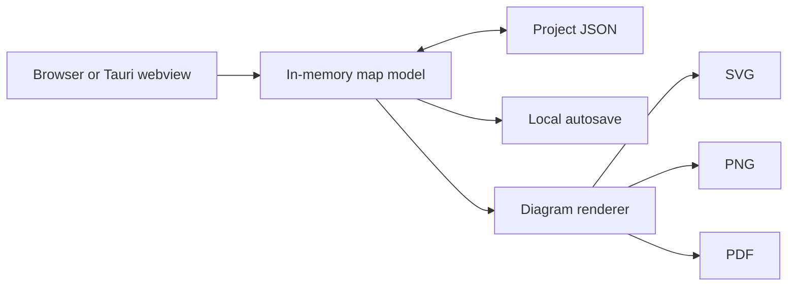

<div align="center">

# Process Map Builder

**Create structured, presentation-ready process maps without sending project data to a backend.**

[](https://cardoso-diogo.github.io/ProcessMapApp/)
[](https://github.com/cardoso-diogo/ProcessMapApp/releases/latest)
[](https://github.com/cardoso-diogo/ProcessMapApp/releases/latest)
[](LICENSE)

[Open the web app](https://cardoso-diogo.github.io/ProcessMapApp/) · [Download for Windows](https://github.com/cardoso-diogo/ProcessMapApp/releases/latest) · [Report an issue](https://github.com/cardoso-diogo/ProcessMapApp/issues)

</div>

## Overview

Process Map Builder is an offline-first editor for layered manufacturing and
business process maps. It combines process flow, supporting information, and
export-ready presentation in one interactive canvas.

The application is built with framework-free HTML, CSS, and JavaScript. It can
run directly in a modern browser or as a portable Windows desktop application
powered by [Tauri](https://tauri.app/). No account, database, or application
server is required.

> [!NOTE]
> The example map contains fictional training data. The public repository does
> not include production data or company-specific process information.

## Highlights

- Build maps from **phases and operations**, with optional groups and nested
  subgroups.
- Define **inputs and outputs per operation** or once for an entire group or
  subgroup. Shared I/O is drawn outside the group boundary.
- Capture requirements, software, equipment, input and process parameters,
  defects, monitoring, SPC, and other configurable information layers.
- Add process steps, decisions, scrap flows, multiline operation titles, and
  multiline flow labels.
- Switch between English and Portuguese interfaces.
- Choose from seven visual themes and customize layout, dimensions, colors,
  layer visibility, and layer order.
- Edit directly from the inspector or by double-clicking elements on the map.
- Zoom, pan, fit the drawing to the viewport, and navigate large maps with the
  minimap.
- Undo and redo up to 80 editing states, with automatic local recovery.
- Export to **SVG**, **PNG**, or **PDF**, including single-page and tiled A4/A3
  PDF layouts.
- Save projects as portable JSON files and reopen them later.

## Choose how to run it

| Edition | Best for | Installation | Updates |
| --- | --- | --- | --- |
| [Web app](https://cardoso-diogo.github.io/ProcessMapApp/) | Fast access and easy sharing within a team | None | Automatically follows `main` |
| [Portable Windows app](https://github.com/cardoso-diogo/ProcessMapApp/releases/latest) | Local desktop use and offline access | None; run the downloaded `.exe` | Download each tagged release |
| Local browser copy | Air-gapped or repository-based use | Clone/download, then open `app/index.html` | Update the local repository |

The portable build targets 64-bit Windows. It uses Microsoft Edge WebView2,
which is already present on most current Windows 10 and Windows 11 systems.

> [!IMPORTANT]
> Windows releases are currently unsigned. Microsoft SmartScreen may therefore
> show an **Unknown publisher** warning. Verify the file against the included
> `SHA256SUMS.txt` before running it when provenance matters.

## Quick start

1. Open the [web app](https://cardoso-diogo.github.io/ProcessMapApp/) or launch
   the portable Windows executable.
2. Select **Example** to explore a complete fictional map, or select **New** to
   start from a blank project.
3. Add a phase, then add operations from the structure panel on the left.
4. Select an operation and enter its flow, I/O, grouping, and information-layer
   details in the inspector on the right.
5. Use the settings panel to choose the active layers, theme, map dimensions,
   and PDF options.
6. Select **Save project** to keep an editable `.json` copy.
7. Export the finished map as SVG, PNG, or PDF.

Long text wraps automatically in flow nodes, titles, subtitles, and map cells.
For layer fields, one line represents one item and its display code is generated
automatically.

### Group and operation I/O

Operation-level I/O remains the simplest choice and does not require groups.
When multiple adjacent operations share the same boundary conditions, assign
them to a group or subgroup and define shared I/O on that group instead:

| Scope | Use it when | Placement on the map |
| --- | --- | --- |
| Operation | An input or output belongs to one operation | Attached to that operation |
| Group | Several operations share the same I/O | Once, above and outside the group box |
| Subgroup | A nested sequence has its own shared I/O | Once, above and outside the subgroup box |

Operation-specific I/O can still be used inside a group, so the two approaches
can be combined.

## Files, recovery, and exports

- **Project files** are human-readable JSON documents containing the editable
  map model and presentation settings.
- **Automatic recovery** stores the latest working state in the browser or
  desktop webview's local storage. When an unsaved state is found after a
  restart, the application offers to restore it.
- **SVG** is the best option for scalable editing and high-quality documents.
- **PNG** produces a raster image at the configured export scale.
- **PDF** supports one large page or tiled A4/A3 pages in portrait or landscape.
  Vector text is compact and selectable; Unicode image mode prioritizes faithful
  rendering of arbitrary alphabets.

Saving a project and exporting a map are separate actions. Keep the JSON project
file if the map may need to be edited again.

## Architecture



There is no backend service. The same application code and renderer are used by
the browser and desktop editions.

## Data and privacy

Map content is processed locally. The application has no analytics, telemetry,
remote database, or map-data upload feature. Opening the hosted web edition
still makes ordinary requests to GitHub Pages for the static application files,
but project content is not sent with those requests.

Keep these limitations in mind when working with sensitive information:

- Browser and desktop autosave data is stored locally but is **not encrypted by
  the application**.
- The application does not provide authentication, access control, audit logs,
  or collaborative editing.
- Anyone with access to an exported map or saved JSON file can read its content.
- Avoid shared browser profiles and shared computers for confidential projects.
- Review project files, screenshots, exports, issues, and pull requests before
  sharing them or adding them to source control.

For regulated or highly confidential workflows, use an approved local build and
apply your organization's device, storage, backup, and information-handling
controls.

## Development

### Browser edition

No dependency installation or build step is required:

```powershell
git clone https://github.com/cardoso-diogo/ProcessMapApp.git
Set-Location ProcessMapApp
Start-Process app/index.html
```

You can also serve `app/` through any static HTTP server. The application does
not require Node.js at runtime.

### Windows desktop edition

Install the stable Rust toolchain and the Tauri v2 prerequisites for Windows,
then run:

```powershell
Set-Location src-tauri
cargo install tauri-cli --version "^2" --locked
cargo tauri build --no-bundle
```

The portable executable is written to:

```text
src-tauri/target/release/process-map-builder.exe
```

Running `cargo tauri build` without `--no-bundle` builds the configured NSIS
installer instead.

## Testing

Open `app/ProcessMap_Tests.html` in a browser. The page title and summary report
the result of the browser-based regression suite.

When Node.js is available, run these quick syntax checks:

```powershell
node --check app/ProcessMap_Core.js
node --check app/ProcessMap_UI.js
node --check app/ProcessMap_Export.js
node --check app/ProcessMap_Tests.js
```

The regression suite covers project normalization, save behavior, long-label
wrapping, grouped and ungrouped I/O, legacy project migration, diagram rendering,
SVG escaping, PDF generation, themes, and SPC content.

## Automated publishing

Two GitHub Actions workflows handle distribution:

- A push to `main` publishes the contents of `app/` to GitHub Pages.
- A version tag matching `v*` builds a portable Windows x64 executable, creates
  a GitHub Release, and attaches both the executable and its SHA-256 checksum.

To publish a release after updating the version in `src-tauri/tauri.conf.json`
and `src-tauri/Cargo.toml`:

```powershell
git tag -a v1.2.0 -m "Process Map Builder v1.2.0"
git push origin v1.2.0
```

## Project layout

```text
ProcessMapApp/
|-- app/
|   |-- index.html                 # GitHub Pages entry point
|   |-- ProcessMap_Builder.html    # Application shell
|   |-- ProcessMap_Builder.css     # Interface and responsive layout
|   |-- ProcessMap_Core.js         # Model, validation, layout, and renderer
|   |-- ProcessMap_UI.js           # Editing UI and interactions
|   |-- ProcessMap_Export.js       # SVG, PNG, and PDF export support
|   `-- ProcessMap_Tests.*         # Browser regression suite
|-- src-tauri/                     # Tauri v2 desktop wrapper
|-- .github/workflows/             # Pages and Windows release automation
|-- LICENSE
`-- README.md
```

## Contributing

Bug reports and focused pull requests are welcome. Before opening a change:

1. Run the browser regression suite and JavaScript syntax checks.
2. Keep the browser edition dependency-free unless a dependency is clearly
   justified.
3. Use fictional, generic data in examples and tests.
4. Do not include company names, production parameters, controlled documents,
   personal data, credentials, or other confidential information.

## License

Process Map Builder is released under the [MIT License](LICENSE).
